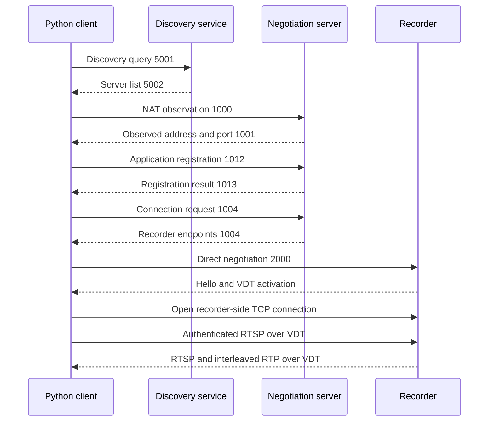

# Implemented protocol

This reference describes the subset observed and implemented by this project.
It is not official vendor documentation. Stage names are project terminology.
Message numbers and layouts were checked with the owner's recorder; other
firmware may behave differently. See [Provenance](provenance.md) for the
research method and [Validation](../development/validation.md) for test evidence.

## Connection sequence

The registration socket and recorder session socket are distinct. The device
offer can arrive on the registration socket while the connection-request
confirmation arrives on the session socket. Ignoring the former prevents the
connection from completing.

## Cloud discovery and negotiation

Messages in this family start with two little-endian `uint16` values: magic
`0x2012` and message type.

| Stage | Message types |
| --- | --- |
| Discovery | 5001 / 5002 |
| NAT observation | 1000 / 1001 |
| Application registration | 1012 / 1013 |
| Connection | 1004 / 1005 |
| Direct hello | 2000 / 2001 |

In a discovery response, the first 16 bytes are the TEA key. A little-endian
`uint32` at offset 16 gives the length of the ciphertext beginning at offset 20.
The decoded payload is an ASCII list with three fields per line:
`ipv4:port|hostname|hostname_ipv6`. The implementation validates lengths,
addresses, and ports before use.

A registration request is 160 bytes: a 16-byte header containing randomness,
a 32-byte application-key field encrypted with TEA, a 100-byte client identity,
and three `uint32` values for version, NAT type, and client type. The 52-byte
response returns a result, interval, timestamp, and encrypted key. The client
checks acceptance, timestamp freshness, and key equality.

A connection request includes client identity, target serial, observed and local
addresses, version, and the hexadecimal MD5 of the P2P password. The application
key, P2P password, and RTSP password serve distinct purposes. Their actual values
are not distributed in the tests. See [Cloud credentials](../guides/credentials.md)
for the input mapping.

TEA and MD5 reproduce the legacy wire format. In discovery and registration,
the TEA key is the transmitted packet header, so it does not provide
confidentiality against a traffic observer. The tunneled RTSP authentication
exchange and video are also carried without transport encryption. RTSP Digest
authentication does not encrypt the media.

## VDT transport

The header begins with bytes `12 01 10`, followed by a command. Internal VDT
numeric fields use network byte order.

| Command | Implemented behavior |
| --- | --- |
| 0 | Hello with timestamp, sequence, and window |
| 1 | Hello response |
| 2 | Data with sequence and length |
| 3 | ACK, highest sequence, and missing-packet list |
| 4 | ACK request |
| 5 | MTU probe |
| 6 | MTU probe response |

The client advertises a bounded window, reorders data, discards duplicates, and
requests retransmission of missing ranges. Outgoing payloads are split into
chunks of at most 1,200 bytes. Retry counts and pending packets are bounded.
Counters and identifiers are kept separate from credentials and URLs.

The ordered stream carries application frames with a little-endian header:
`uint16 client_id`, `uint16 type`, `uint32 length`, followed by payload. Type 0
carries TCP bytes. Client 65535 is reserved for control: type `0xFF01` opens a
connection and `0xFF02` closes it. An open request includes the stream identifier,
recorder-side address `127.0.0.1`, and destination TCP port.

Hello must be sent in both directions. Only responding to the recorder's hello
does not advertise the client's receive window and prevents video from returning.

## Unsupported paths

Cloud relay, IPv6 negotiation, and legacy variants without VDT are not
implemented. Connectivity depends on the firmware and remote service. Removing
the Cloud dependency would require direct IP/VPN access or another mechanism
the recorder accepts; the client cannot change the recorder's capabilities.
